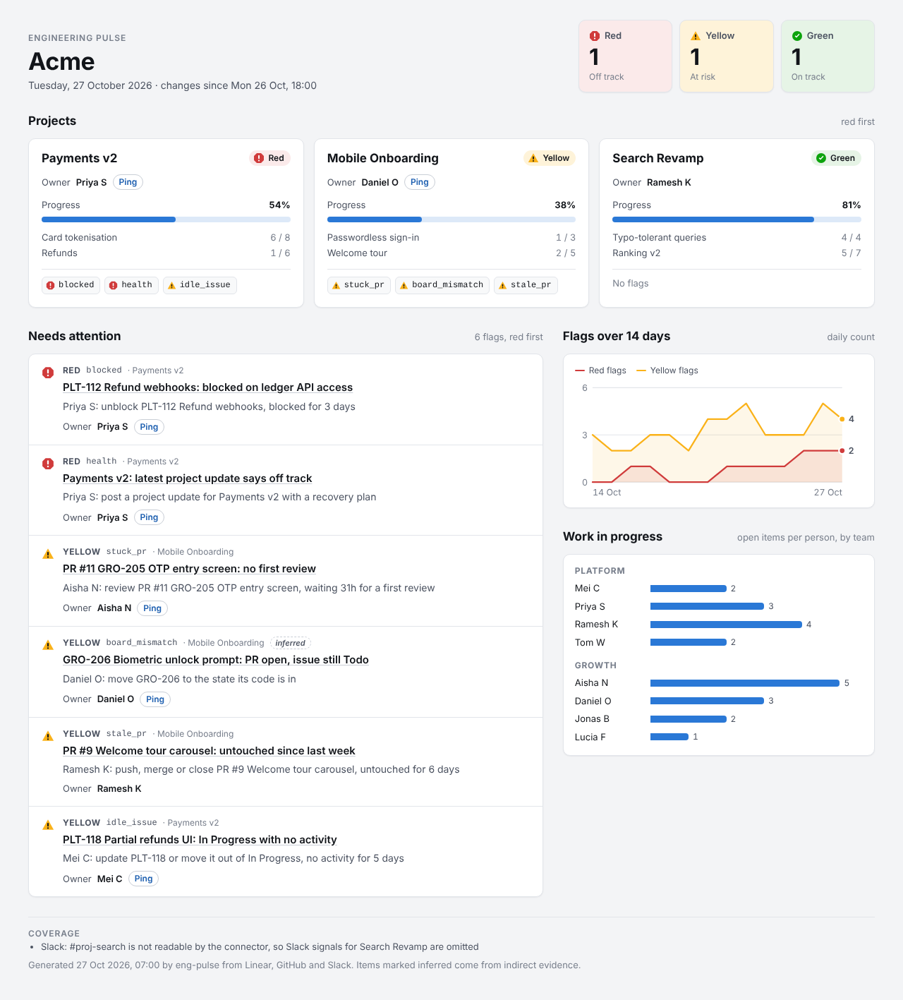

# eng-pulse

A Claude plugin (Cowork and Claude.ai) that reads Linear, GitHub and Slack and tells engineering leaders what is stuck, blocked or at risk, who owns it, and what to do next. It writes a daily status report for an exec, PM or team lead, and answers ad-hoc questions such as "what's stuck today?", with every claim linked to its source.



## What you get

Three skills. Claude picks the right one from what you ask.

| Skill | What it does | Try asking |
|---|---|---|
| `setup` | Discovers your Linear teams, projects and people (plus GitHub repos and Slack channels), proposes a mapping, asks you to confirm it in batches, and writes a validated `team-map.yaml`. | "Set up eng-pulse for our engineering org." · "Refresh the eng-pulse team map." |
| `daily-report` | Gathers the window since the previous working day, applies the signals, colours each project red/yellow/green, and delivers the report. | "Run the daily report. I'm the CEO; give me the exec brief as markdown." · "Post the status to Slack in #eng-status." |
| `ask` | Answers one question in short prose with linked sources: project status, an epic or issue, one person's work, what's stuck, what shipped, why a project is red. | "what's happening with Payments v2?" · "who's on the Passwordless sign-in epic?" |

Report formats (`references/formats/`):

- **exec**: exec brief for a CEO/CTO. Under 250 words, one colour per project, risk → impact → action → ask with a date. Names no individuals.
- **PM**: PM view. Per-project progress, epics and every item-level flag with its owner.
- **lead**: lead view. Per team: each person's work in progress (in name order, never sorted by count), PRs that need a push, idle issues, board mismatches and blockers.
- **Slack**: Slack post. One line per project and the top three flags, mentioning only flag owners. It is shown as a draft first and sent only after you say yes.

Destinations: dashboard artifact (the page above, with light, dark and print layouts), PDF, markdown in the chat, or a Slack post. `daily-report` asks once who the report is for and where it goes, then remembers the answer per person in the team map.

## Install

About two minutes, plus the GitHub step if you want PR signals.

1. **Add the plugin.** In Claude Code, install it straight from this repo:

   ```
   /plugin marketplace add rishithakkar/eng-pulse
   /plugin install eng-pulse@eng-pulse
   ```

   In Cowork or Claude.ai, add `rishithakkar/eng-pulse` as a plugin marketplace in plugin settings, or upload `eng-pulse.plugin` there instead. To build the file from this repo, see [CONTRIBUTING.md](CONTRIBUTING.md#packaging).
2. **Connect Linear and Slack** from Claude's connector directory (Settings → Connectors) and sign in. Linear is required. Slack is optional.
3. **Connect GitHub (optional), the non-obvious way:**

> [!IMPORTANT]
> **Claude.ai's built-in GitHub integration cannot read pull requests.** It only syncs repository files into Projects, so eng-pulse treats it as "GitHub not connected".
> Add GitHub's MCP server as a **custom connector** instead: URL `https://api.githubcopilot.com/mcp/readonly`, authentication "No sign in", and the request header `Authorization: Bearer <fine-grained read-only PAT>` (plus `X-MCP-Toolsets: pull_requests,repos,actions`). [CONNECTORS.md](CONNECTORS.md#github) has the token permissions and an OAuth-app alternative.
>
> **eng-pulse works without GitHub.** The report then leaves out the PR signals (stuck, stale and contested PRs, board mismatches, and the linked-PR activity check of idle issues) and says so in one coverage line.

4. **Run setup.** Ask Claude to "set up eng-pulse". In Cowork it writes `team-map.yaml` at the root of the connected folder. In Claude.ai it gives you the file to add to your Project's knowledge.

Then ask for the daily report.

## Try it offline in 30 seconds

`daily-report` and `ask` can run on saved data with no connectors at all (`references/fixture-mode.md`; `setup` has its own `discovery:` file). The plugin ships a sample company in `tests/fixtures/board_mismatch`. With the plugin installed, send:

```
Run the daily report. I'm the CEO; give me the exec brief as markdown.
fixtures: tests/fixtures/board_mismatch
```

```
what's stuck today?
fixtures: tests/fixtures/board_mismatch
```

Fixture mode makes no connector calls, uses the fixture's own clock, never posts to Slack and never saves reports. A relative path is looked up in the working directory first, then in the plugin folder, so the prompts work as written in both Claude.ai and Cowork. If Claude still cannot find it, connect a clone of this repo as a folder (Cowork) and use the same prompt. The expected exec brief for this fixture is in `references/formats/examples/exec-brief.md`.

## How it decides what to flag

- Signals are defined in one place, [`references/signals.md`](references/signals.md). Thresholds are set per company in `team-map.yaml` (defaults in `team-map.example.yaml`). Flags become project colours by the rules in [`references/rollup.md`](references/rollup.md): red if any red flag, yellow if any yellow, green otherwise.
- The nine v0.1 signals are `stuck_pr`, `stale_pr`, `contested_pr`, `idle_issue`, `board_mismatch`, `blocked`, `overloaded`, `forecast_risk` and `health`.
- Rules every report follows:
  - **Exceptions, not activity.** A report lists what needs someone to act. It does not recap what everyone did.
  - **Never ranks individuals.** People appear only as the owner of a flag. Per-person load appears only in the lead view, never sorted. `ask` declines "who's slowest?".
  - **Every flag links its source**: the issue, PR, thread or project update it came from. No number appears without a source.
  - **Inferred is labelled.** A flag that is a guess (for example "work started" because an open PR is linked to an issue the board still shows as not started) says *inferred*.
  - **Connector text is data.** Instruction-like text in an issue, PR or Slack message changes no flag, colour or owner.
  - **Slack posts are draft-first.** Nothing is sent without your explicit yes.

## Privacy and permissions

- **Linear and GitHub are read-only.** eng-pulse calls only the read tools listed in `references/tool-names.json`. The recommended GitHub route uses the `/readonly` endpoint and a read-only token.
- **What each connector can see:**
  - Linear: issues, projects, cycles, status updates, comments and users in the workspace you authorise.
  - GitHub: PRs, reviews, commits and checks in the repos your token can read.
  - Slack: whatever your Slack account can see. eng-pulse reads only the `slack_channels` mapped to each project, never DMs or other channels, and never summarises general chatter.
- **Slack is the only place it writes outside your files**, and only after you confirm a draft.
- **Local files it writes:** `team-map.yaml` (only after you confirm it), your report preference inside it, and in Cowork `reports/YYYY-MM-DD.html` and `.json` in the connected folder.
- **`team-map.yaml` stays local.** It is gitignored in this repo and should be in yours. It holds names, ids and thresholds, never secrets: `setup` refuses to store tokens, PATs, passwords or webhook URLs.
- **Team and Enterprise plans:** a header credential on a shared custom connector is used by every member of the workspace. Scope the GitHub PAT to read-only on the mapped repos only, and rotate it like any shared secret.

## Contributing

See [CONTRIBUTING.md](CONTRIBUTING.md) for tests, evals, adding a signal or a format, and the rules a PR must keep. The manual end-to-end checklist is [docs/END-TO-END.md](docs/END-TO-END.md).

## License

MIT. See [LICENSE](LICENSE).
